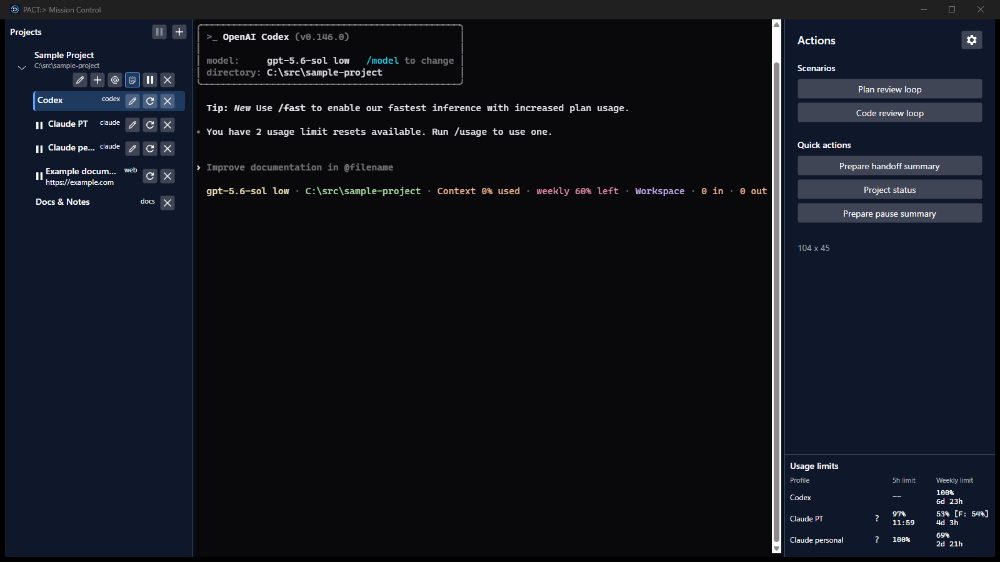
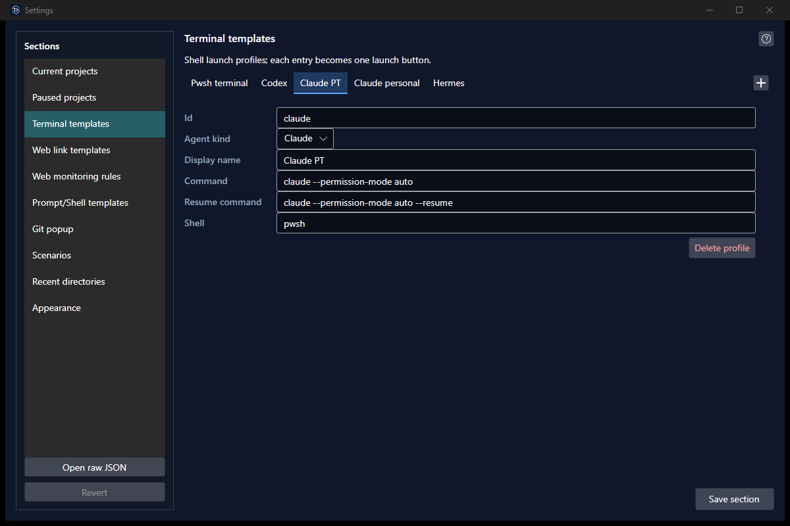

# PACT:> Mission Control

[English](README.md) | [Русский](README.ru.md)

PACT:> Mission Control is a Windows desktop cockpit that keeps coding-agent
terminals, project context, documentation, and operational links visible in
one place.





## What it does

- Runs visible Codex, Claude, PowerShell, and custom terminal sessions
  through the bundled Windows ConPTY and xterm.js.
- Keeps live sessions running while you switch between terminals, project
  Markdown, notes, and native WebView2 browser tabs.
- Provides explicit prompt, selection, Git, and fixed author/reviewer scenario
  actions without turning subscription TUI tools into a hidden API.
- Lets agents inside a visible session ask Pact to start a review, read,
  append, or revision-safely replace project Notes, and open a browser tab.

- Persists projects and nested sessions under one selectable data root.
- Provides a project **Board** with Backlog, Ready, In Progress, Verification and
  Done cards, comments, manual ordering and a Done archive. Ordinary project
  agents share the same board through MCP. “Take next” claims only the first
  Ready card; an empty queue stays empty. Jira links are optional references.
- Opens each project on **Overview · Board · Docs · Changes · Review logs**. Overview
  keeps Notes below repository information, installed IDEs, active reviews and
  durable agent-added links; Docs browses and edits all project Markdown.
- Changes offers **Uncommitted** (HEAD → local), **Unmerged** (merge base with a
  chosen target → local), and **Unpushed** (tracking ref → local, falling back to
  the Unmerged base when tracking is not configured). All include current files
  and nonignored untracked changes. Three independent right-panel summaries open
  the matching scope. Remote refs reflect the last fetch/pull; nothing fetches
  automatically. Explicit **Pull (rebase)** requires a clean tree and never autostashes.
  Unmerged/Unpushed can filter to local edits or one local-side commit; standalone
  history and SHA/ref selection remain available.
  Individual commits use the first parent (empty tree for an initial
  commit), retain Diff / Whole file / Rendered modes and keep remarks tied to
  the exact target and comparison-base SHAs.
- Resolving the last project remark offers to clear the whole review list. Declining
  keeps it; a separate cleanup action remains available when the list is closed.
- Keeps persistent project-independent ROOT terminal and browser tabs above the
  project tree, with explicit per-tab pause and resume.
- Clicking ROOT opens a dashboard of open projects, live agents and uncommitted
  changes. Closing a selected project tab returns to its Overview; closing a
  ROOT tab or closing/pausing the current project returns to the dashboard.
- Opens terminal HTTP(S) links as saved browser tabs under the same project or
  ROOT, supports exact custom URLs, and persists drag-and-drop tab ordering.
- Monitors configured loaded web pages while they are hidden.

PACT:> is Windows-only. The supported package is framework-dependent
`win-x64`; there is no cross-platform product head.

## Requirements

To run a release manually from the portable ZIP:

- Windows 11 x64;
- [.NET 10 Runtime x64](https://dotnet.microsoft.com/download/dotnet/10.0);
- [Microsoft Edge WebView2 Runtime](https://developer.microsoft.com/microsoft-edge/webview2/).

The Setup package checks these two runtimes and offers to install a missing
one before PACT. You do not need to install them in advance when using Setup;
an Internet connection is required only when a prerequisite must be downloaded.

Coding-agent CLIs are not bundled. Install each CLI you intend to use and make
its command available on `PATH`; the starter profiles call `codex`, `claude`,
and `pwsh`. The built-in PowerShell profile therefore also requires
PowerShell 7.

Contributors also need the .NET 10 SDK, Node.js 22 or newer, and PowerShell 7.

## Install a release

Download the Setup executable and `SHA256SUMS.txt` from the
[latest release](https://github.com/s-titov-82/pact-mission-control/releases/latest).
Compare Setup's SHA-256 digest before running it:

```powershell
Get-FileHash .\pact-mission-control-0.1.12-win-x64-setup.exe -Algorithm SHA256
```

Run Setup and follow its prompts. It installs PACT for the current user under
`%LOCALAPPDATA%\Programs\Pact Mission Control` by default, but you may choose
another directory. A later interactive Setup remembers that chosen directory.
Setup creates a Start menu shortcut and can optionally create a desktop
shortcut. Installing or uninstalling PACT does not remove the data under
`%APPDATA%\Pact`.
Run a newer Setup to upgrade in place; Setup blocks installing an older version
over a newer one. Close PACT normally before upgrading so live agents are not
terminated while files are replaced.

PACT checks the stable GitHub release channel at startup and then
once per hour. When a newer `vMAJOR.MINOR.PATCH` release is available, PACT
shows its release notes and asks before downloading it. The verified Setup is
staged under the PACT data root. Once no terminal is busy, no review is active,
and shutdown has not begun, PACT offers `Restart and update`. The helper waits
until both PACT and its bundled ConPTY executable are no longer locked, updates
the directory containing the running `Pact.App.Avalonia.exe`, deletes the Setup
package, and relaunches PACT without requesting a Windows reboot.

Every launch restores the tabs that were active before the previous exit,
their selection, unread completion markers, and manual `Read later` bookmarks.
Double-click a ready agent row to toggle `Read later`; visiting it does not clear
that bookmark. Busy and input-request states wait for fresh agent screen evidence.
An agent terminal with
an extracted conversation id resumes that conversation directly; one with only a
resume command template resumes into the agent's own conversation picker, which
is also how a session survives an unexpected exit. Other terminals cold-start
and are named in the restoration summary. Tabs that
were paused stay paused.

The ZIP remains available as a portable/manual alternative. It requires the
two runtimes listed above to be installed first; extract it to a user-writable
directory and start `Pact.App.Avalonia.exe`.

The first public releases may be unsigned by Authenticode, so Windows
SmartScreen can warn. See [Release verification](docs/release-verification.md)
for checksum, SPDX SBOM, and GitHub attestation checks.

## First run

1. Start PACT from the Start menu (or run `Pact.App.Avalonia.exe` from the ZIP).
2. Click `+` beside `PROJECTS` and select the repository directory.
3. Add a terminal session from the project card, choose a launch profile, and
   start it.

For an agent session, dashboard, or shell that is not tied to a
repository, use the `+` or `@` action in the expanded `ROOT` section. New ROOT
terminals start in the current Windows user's existing profile directory.

PACT:> stores durable settings in `%APPDATA%\Pact` by default. Use an isolated
absolute profile when evaluating the application:

```powershell
.\Pact.App.Avalonia.exe --data-root C:\Pact-Test
```

Only one process can own a data root at a time.

## Pact guidance inside agent sessions

When Pact starts or resumes a Codex or Claude terminal, it preserves the selected
profile command and adds a short, session-scoped instruction pointing to
Pact-owned guidance under `Temp/Retained/PactSkills`. The detailed guidance is
read only when needed; it is not copied into every prompt. With agent control
enabled, supported sessions also receive an ephemeral connection to Pact's
loopback MCP server. Session launch leaves global Codex and Claude configuration untouched.

In **Settings → Agents → Terminal profiles**, select a profile and check its CLI, version,
runtime dependencies, and skill directories. Opening a test terminal gives Pact
a visible session for observing startup and MCP initialization.

Open **Skill catalog** beside the settings gear in the main window or at the
top of the Settings sidebar. The catalog reads `~/.agents/skills` and the native
Codex and Claude skill directories, including links into a team checkout.
On **Catalog**, expand a source to see its skills. Use **Add a skill source**
to browse a repository folder or public GitHub URL. Select a package to read
its files. An existing shared installation offers **Link update source…** for
choosing its update repository. Review the matching package before binding it.
**Check for update** shows the destination, changed files and available release
notes before you apply the update. **Make shared** moves a profile's package
into `~/.agents/skills` and leaves a directory link in its original location.
When the shared folder already has an identical package, Pact reuses it.
**Rename folder…** changes the installed directory name. The preview shows
the old and new paths and the connections and settings that need updating.
The package keeps the `name` declared in `SKILL.md`. When that differs from
the folder name, Catalog and Skill → Agent mapping display both.
**Find duplicates** lists the locations of independent copies and their
differences. Use **Delete** on the specific location to preview its removal.
For a directory link the removal applies only to that link.
Pact flags locally modified managed packages before replacing their files.

Open **Skill → Agent mapping** to edit defaults, a project or a folder and its
descendants. **Skill mapping** beside the pencil on a project's Overview
opens the table with that project selected. Each column is a launch profile.
Select a project or a parent directory in the tree on the left. **Add directory**
adds an unopened project or a folder whose mapping covers its descendants.
A private installation has controls in its owning
profile. Use **Make shared** in the catalog to configure it for other profiles.
Set a source to **Off** to disable its skills for
that profile and scope. Expand the source to give an individual skill an
exception. Saved source rules also cover skills added later when launching
through Pact. **Inherit** checks the source at the same scope, then the nearest
configured parent folder and finally the profile default. Folder rules apply
at launch based on the terminal's working directory, including future projects.
The table shows affected profiles and files before you apply changes. Defaults written
to native configuration work when starting the
same native profile from a terminal. Claude project visibility also works
there. Codex project visibility overrides take effect on the next launch
through Pact. Codex discovers skills in project discovery folders directly.
When a preview creates a directory connection inside a Git project, Git may
stage the linked skill files. Exclude that project-relative path locally if
the connection should stay on this machine.

Saving Settings reloads the live scenario and review-profile catalogs. Existing
connected agents receive an MCP tool-list change notification when the set of
available ids changes, so restarting their terminal is unnecessary. Direct
external edits are observed only after that Settings reload boundary or an
application restart.

Open **MCP catalog** under **Settings → Agents** or from the project's
**Overview**. Select a Codex or Claude launch profile to see declarations
in its native files and in the selected project. Edit native entries with
the agent. Use **Add server** to register a streamable HTTP or stdio server
in Pact, then set it **On** under **Profile defaults**. For one project,
choose **Inherit**, **On**, or **Off**. Before **Apply**, Pact shows the
affected profiles and the settings file it will write. ROOT sessions started
from a launch profile use its defaults.

After starting or restarting the session, open `/mcp` in the agent and find
the server by the `pact_catalog_` name shown in the catalog. The agent reports
connection and authentication status. Supply credentials through environment
variable names or the agent's own sign-in. For stdio, install and update the
executable with its own package manager. Edit a registered endpoint or command
in Pact and review the affected profiles before applying the new definition.

## Build from source

```powershell
dotnet tool restore --disable-parallel
dotnet restore Pact.slnx --disable-parallel --locked-mode
dotnet build Pact.slnx --no-restore -m:2 -nr:false -v q -p:BuildInParallel=false
```

Node.js is required by the full terminal-host behavior suite, not by the
released application. This sequence only builds the source tree. See
[Development](docs/development.md) for the complete bounded test matrix,
native Windows gates, packaging validation, and maintainer release procedure.

## Documentation and contributing

- [User guide](docs/guide/en/README.md)
- [Settings reference](docs/help/en/README.md)
- [Documentation index](docs/README.md)
- [Architecture](docs/architecture.md)
- [Contributor workflow](docs/development.md)

## License

PACT:> Mission Control is licensed under the [MIT License](LICENSE).
Bundled and vendored dependencies retain their own terms; see
[THIRD-PARTY-NOTICES.md](THIRD-PARTY-NOTICES.md) and the `licenses` directory.
